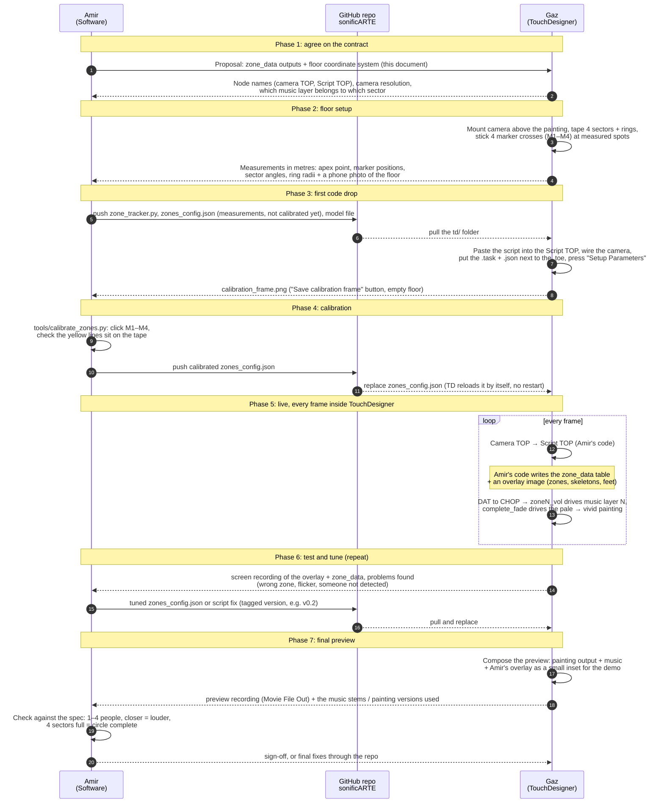

# sonificARTE: how Software and TouchDesigner work together

**Amir: Software.** Tracking, floor zones, calibration and the data contract.
**Gaz: TouchDesigner.** The TD network, camera, music layers, painting, projection and the final preview.

Amir's code runs **inside** Gaz's TouchDesigner project as a Script TOP, so there is only one program at the show. Amir never edits the `.toe` file, and Gaz never edits the Python code. They exchange files through this GitHub repo.

## 1. Who owns what

| | Amir (Software) | Gaz (TouchDesigner) |
|---|---|---|
| Files | `td/scripts/zone_tracker.py`, `td/zones_config.json`, `tools/`, `tests/`, this document | the `.toe` / `.tox` files, music stems, painting images |
| Camera → people | MediaPipe pose detection, finding each person's feet | camera hardware, mounting, the Camera TOP |
| People → zones | floor calibration, sector/ring geometry, debouncing, volume curve | taping the real floor, measuring the marker positions |
| Zones → experience | delivers the `zone_data` table (the contract below) | maps `zone_data` to music layer volumes and the pale → vivid painting fade |
| Show | tuning `zones_config.json` on site | projector, speakers, final preview / recording |

## 2. Sequence diagram



## 3. The contract: what Gaz gets from Amir's code

### Inputs Amir's code expects from Gaz

| Input | Where | Notes |
|---|---|---|
| Camera image | Script TOP input 1 (or the TOP named in `CAMERA_TOP`, default `null17`) | camera above the painting, angled down at the floor. Visitors' **feet must be visible**. |
| `pose_landmarker_lite.task` | next to the `.toe` file | the MediaPipe model, already in `td/` |
| `zones_config.json` | next to the `.toe` file | written by Amir. Gaz only copies it. |

### Outputs Gaz gets from Amir's code

1. **The Script TOP image:** the camera picture with the real floor zones, skeletons and feet drawn on it. It can be switched off with the *Show zones overlay* toggle.
2. **The `zone_data` Table DAT**, created next to the Script TOP. Turn it into channels with a **DAT to CHOP** (*Output: Channel per Row*, *First Column is Names*).

| Channel (i = 1..4) | Range | Use it for |
|---|---|---|
| `zone{i}_on` | 0 / 1 | layer i plays (someone is standing in sector i) |
| `zone{i}_vol` | 0 … 1 | layer i volume. Closer to the painting = louder. Already smoothed, 0 when empty. |
| `zone{i}_ring` | 0, 1, 2, 3 | which ring the nearest person stands in (1 = nearest the painting, 0 = empty) |
| `zone{i}_dist` | metres | distance of that person from the apex point |
| `zones_on` | 0 … 4 | how many layers are playing |
| `people` | int | how many people the camera sees, inside or outside the zones |
| `complete` | 0 / 1 | all 4 sectors are occupied: the circle is complete |
| `complete_fade` | 0 … 1 | ramps up over 3 s while complete and back down when not. Feed it into the cross-fade from the pale to the vivid painting. |
| `calibrated` | 0 / 1 | 0 means the zones are not calibrated yet, so no layer will play |

For compatibility, the script also keeps the previous `scriptOp.store('zones', [...])` list of 4 booleans.

### Buttons on the Script TOP (*sonificARTE* page, after "Setup Parameters")

- **Show zones overlay:** draw the zones on the image, or not.
- **Save calibration frame:** writes `calibration_frame.png` next to the `.toe`. Send this file to Amir.
- **Reload zones_config.json:** forces a reload. The script also reloads the file automatically when it changes.
- **Reset zone state:** sets all zones to off.

## 4. Floor zones: real metres instead of image lines

The previous script drew a fixed fan of lines on the **camera image**. Because the camera looks at the floor at an angle, those lines don't match the tape on the floor, and a step towards the painting doesn't cover the same number of pixels everywhere.

Now the zones are defined **on the floor, in metres**. Four taped calibration markers tell the script how the camera image maps onto the floor.

```
                  PAINTING (wall)          camera above it, looking down at the floor
   ───────────────────●───────────────────
                     apex (0, 0)
            sector 1 / sector 2 | sector 3 \ sector 4      +x → visitor's right
                    /  ring 1   |   ring 1  \              +y ↓ into the room
                   /   ring 2   |   ring 2   \
                  /    ring 3   |   ring 3    \
     M4 ✚ (-1.5, 3.5)                     M3 ✚ (1.5, 3.5)
     M1 ✚ (-1.5, 1.0)                     M2 ✚ (1.5, 1.0)     (example positions)
```

- **Origin:** the apex point on the floor in front of the painting (the "spider" in the sketch).
- **x:** metres to the right of a visitor who faces the painting. **y:** metres away from the painting.
- **Sector 1** is the visitor's far left, **sector 4** the far right.
- `zones.sector_edges_deg`: 5 angles give 4 sectors. 0° is straight out from the painting. The default is `[-60, -30, 0, 30, 60]`.
- `zones.ring_edges_m`: distances from the apex. The default is `[0.5, 1.5, 2.5, 3.5]`, which gives 3 rings.
- `volume`: `continuous` (default) fades smoothly from `near` = 100 % to `far` = 25 %. With `rings`, each ring has its own level.

### Calibration in 5 steps

1. **Gaz** sticks 4 crosses of coloured tape on the floor, spread wide across the area and **visible to the camera**, not in a straight line. Measure each one with a tape measure from the apex: *x* sideways and *y* away from the painting.
2. **Gaz** sends the 4 measurements to Amir, who puts them in `calibration.floor_points_m` in the order M1, M2, M3, M4.
3. **Gaz** clears the floor and presses **Save calibration frame**, then sends `calibration_frame.png`.
4. **Amir** runs:
   ```bash
   pip install opencv-python numpy
   ```
   ```bash
   python tools/calibrate_zones.py calibration_frame.png --config td/zones_config.json
   ```
   Then **Amir** clicks M1 to M4, checks that the yellow lines lie on the tape, and presses `s` to save.
5. **Amir** pushes `td/zones_config.json`, and **Gaz** copies it next to the `.toe`. TD picks it up within a second.

If the camera moves, only steps 3–5 need repeating. The taped zones and the measurements stay the same.

## 5. How code is shared

- Everything Gaz needs is in the **`td/` folder** of this repo: the script, the config and the model.
- Amir tags versions that work (`v0.1`, `v0.2`, …), and Gaz says which version is in the `.toe`.
- Gaz pastes the script into the Script TOP's callbacks DAT. Better still, Gaz sets that DAT's **File** parameter to `td/scripts/zone_tracker.py` and turns on *Sync to File*. Then a `git pull` updates the code without any copy-paste.
- Problems go into GitHub issues, with a screenshot of the overlay and the `zone_data` table.
- Amir runs the tests without TouchDesigner:
  ```bash
  python -m unittest discover tests
  ```

## 6. Open questions to settle in Phase 1

- The exact floor sizes: apex position, sector angles, ring radii, and how far from the painting the first ring starts.
- Which composed layer goes with which sector (drums = sector 1?).
- What happens when 2 people stand in the same sector. Now the nearest person sets the volume and the layer just plays.
- What happens when a 5th person enters. The script tracks up to `tracking.num_poses` = 4 people, so a 5th may push someone out. It can be raised to 5 or 6 at some cost in frame rate.
- The camera model and resolution. A wide-angle lens helps the camera see the whole floor area.
- Running MediaPipe inside TD lowers TD's frame rate. If the preview stutters, the tracking can move to a separate process that sends the same `zone_data` values over OSC, with no change for Gaz.
